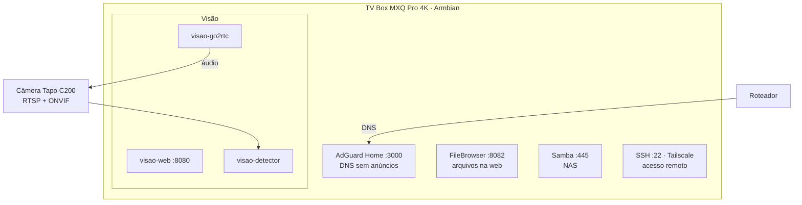

# Mini-Server-LAOB

> TV Box MXQ Pro 4K transformada em servidor caseiro 24/7 de ~3 W: bloqueio de anúncios, NAS, VPN e o Visão, reconhecimento facial com câmera Tapo C200 sem nuvem.

 -red)  

> [!IMPORTANT]
> **Projeto aposentado em nov/2026.** A TV Box saiu de uso e o Visão evoluiu para o
> **[Willbert-LAOB](https://github.com/VituColombo0/Willbert-LAOB)**, que roda num PC do laboratório.
> Este repositório fica como referência e para quem quiser reaproveitar uma TV Box.

## Sumário

- [Sobre](#sobre) · [Funcionalidades](#funcionalidades) · [Arquitetura](#arquitetura) · [Requisitos](#requisitos)
- [Instalação](#instalação) · [Uso](#uso) · [Visão](#visão-reconhecimento-facial) · [Desempenho](#desempenho)
- [Estrutura do projeto](#estrutura-do-projeto) · [Licença](#licença)

## Sobre

TV Boxes com SoC ARM (Rockchip RK322x, Amlogic S905x, Allwinner H3) custam pouco e gastam ~3 W.
Com o Armbian, viram um servidor Linux completo. A instalação é *headless*: grava-se o cartão SD
no computador, liga-se a TV Box na rede e ela se configura sozinha, sem monitor nem teclado.

## Funcionalidades

- Bloqueia anúncios e rastreadores de toda a rede (AdGuard Home).
- Compartilha arquivos pela rede (Samba) e pelo navegador (FileBrowser).
- Dá acesso remoto seguro por VPN (Tailscale) e SSH com chave.
- Reconhece rostos com a câmera Tapo C200 e registra quem esteve no laboratório e quando (Visão).
- Atualiza pelo GitHub (`mxq-update`) e pode migrar do cartão SD para a memória interna.
- Protege o hardware: ZRAM, menos escrita na flash, watchdog, Fail2ban e controle térmico.

## Arquitetura



O Docker é instalado mas fica **desligado** para sobrar ~100 MB de RAM ao Visão
(`sudo systemctl enable --now docker` religa).

**Otimizações do sistema**

- **ZRAM (lz4):** até ~60% mais memória efetiva, evitando falta de memória com 1 GB.
- **Menos desgaste da flash:** `noatime`, `nodiratime`, `commit=60` e journal em memória.
- **CPU:** governor `schedutil`/`ondemand`, estável mesmo sem cooler.
- **Watchdog de hardware:** reinicia sozinho se o sistema travar.
- **Fail2ban:** bloqueia força bruta no SSH e nos serviços web.
- **Manutenção:** limpeza do cache APT; o Visão faz backup noturno e apaga histórico com mais de 7 dias.
- **Proteção térmica do Visão:** acima de 78 °C a análise fica mais espaçada (85 °C: bem mais).

## Requisitos

| Componente | Unidade usada |
| :--- | :--- |
| Dispositivo | TV Box MXQ Pro 4K 5G (placa genérica RK322x) |
| SoC | Rockchip RK322x, 4× Cortex-A7 (ARMv7, 32 bits), 0,6–1,2 GHz |
| RAM | 1 GB DDR3 (+ 485 MB de ZRAM) |
| Armazenamento | 8 GB eMMC ou cartão MicroSD Classe 10/A1 |
| Rede | Ethernet 10/100 + Wi-Fi |
| Consumo | 2,5–4,5 W (fonte 5 V / 2 A) |
| Sistema | Armbian Minimal (Debian Trixie), kernel 6.18 rockchip |
| Câmera (Visão) | TP-Link Tapo C200 |

Computador com Linux ou WSL para preparar o cartão.

## Instalação

1. Baixe o **Armbian Minimal (CLI)** do processador da sua placa e grave a `.img` num MicroSD
   com o [balenaEtcher](https://etcher.balena.io/) ou o [Rufus](https://rufus.ie/).

2. Clone o repositório no computador:

   ```bash
   git clone https://github.com/VituColombo0/Mini-Server-LAOB.git
   ```

3. Monte a partição `rootfs` do cartão e injete a configuração automática (troque o ponto de montagem, o usuário e a senha):

   ```bash
   cd Mini-Server-LAOB && sudo ./prepare_sd_card.sh /media/$USER/armbi_root <usuario> <senha-forte>
   ```

4. Coloque o cartão na TV Box, ligue o cabo de rede e a fonte. O serviço `mxq-bootstrap` instala e
   configura tudo em 10–15 minutos.

5. Opcional — passar do cartão para a memória interna (depois, desligue, tire o cartão e religue):

   ```bash
   sudo mxq-install-internal
   ```

> [!TIP]
> Rodar direto do MicroSD é o mais seguro: não há risco de *brick* e, tirando o cartão, a TV Box
> volta ao Android original. Cartões A1/A2 costumam ser mais rápidos que a eMMC dessas placas.

## Uso

Os serviços ficam no IP da TV Box ou em `mxq-server.local`:

| Serviço | Endereço | Login |
| :--- | :--- | :--- |
| AdGuard Home | `http://<IP>:3000` | criado no 1º acesso |
| FileBrowser | `http://<IP>:8082` | definido na instalação |
| Samba (NAS) | `\\<IP>\Compartilhado` | definido na instalação |
| Visão | `http://<IP>:8080` | definido com `visao-cli senha` |
| SSH | `ssh <usuario>@<IP>` | senha ou chave `id_ed25519` |

> [!IMPORTANT]
> Nenhuma senha fica no repositório. A TV Box gera `/root/server-credentials.txt` (`chmod 600`);
> as credenciais da câmera ficam em `/opt/visao/config.toml`.

**Bloquear anúncios na casa toda:** no roteador, em *DHCP / DNS*, coloque o IP fixo da TV Box como
DNS primário e reconecte os aparelhos.

**Acesso remoto e chaves SSH** (na TV Box):

```bash
cd /root/Mini-Server-LAOB && git pull origin main && sudo ./scripts/setup_ssh.sh
```

```bash
sudo tailscale up --accept-dns=false
```

**Atualizar pelo GitHub:**

```bash
sudo mxq-update
```

## Visão: reconhecimento facial

Módulo em [`visao/`](visao/README.md) que usa a Tapo C200 para registrar **quem foi identificado e
quando**, com foto e vídeo, tudo na TV Box.

- Detecta e reconhece com OpenCV (YuNet + SFace), usando a wheel ARMv7 com NEON do piwheels (2–4× mais rápida que a do Debian).
- Só analisa continuamente quando há movimento (evento ONVIF, giro da câmera ou mudança na imagem); parado, varre a cada 20 s.
- Confirma com duas leituras, aprende amostras novas e tem botão "corrigir" para desfazer erros.
- Alerta "desconhecido" com foto e vídeo de ~30 s em 1080p e página de revisão.
- Cumprimenta com "Bom dia, Nome!" (voz offline espeak-ng + MBROLA pt-BR).
- Apaga histórico, fotos e vídeos após 7 dias; só ficam as amostras de cadastro.

Instalação: `sudo bash visao/deploy/install.sh`. Configuração e `visao-cli` em [visao/README.md](visao/README.md).

## Desempenho

Medido na unidade RK322x de 1 GB:

| Componente | RAM | CPU em repouso |
| :--- | ---: | ---: |
| Armbian base | ~60 MB | < 1% |
| AdGuard Home | ~35 MB | < 0,5% |
| FileBrowser | ~15 MB | < 0,2% |
| Samba | ~20 MB | < 0,5% |
| Tailscale + SSH | ~20 MB | < 0,2% |
| Visão: detector | ~150 MB | ~6% (até ~60% com movimento) |
| Visão: decodificação 720p | ~55 MB | ~23% |
| Visão: gravação 1080p | ~40 MB | ~2% |
| Visão: painel + go2rtc | ~70 MB | < 1% |
| **Total** | **~500 MB** | **~30%** |

Sem o Visão, a TV Box fica ~68% ociosa, a ~66 °C.

## Estrutura do projeto

```text
Mini-Server-LAOB/
├── prepare_sd_card.sh         # prepara o cartão no computador
├── setup_mxq_server.sh        # instalação principal na TV Box
├── autorun-headless.sh        # execução automática após o boot
├── configure_adguard_lists.sh # listas de bloqueio do AdGuard
├── flash_to_sd.sh             # grava Multitool + Armbian no cartão
├── restore_sd_card.sh         # utilitário de restauração de cartão SD
├── systemd/                   # serviço mxq-bootstrap
├── scripts/setup_ssh.sh       # chaves SSH autorizadas
├── config/                    # chaves públicas autorizadas
├── visao/                     # reconhecimento facial (código, deploy, testes)
└── docs/                      # identificação do hardware e guia completo
```

## Equipe

Desenvolvido no **Laboratório LAOB**.

- Victor Colombo

## Licença

Código aberto para uso pessoal, acadêmico e comunitário.
